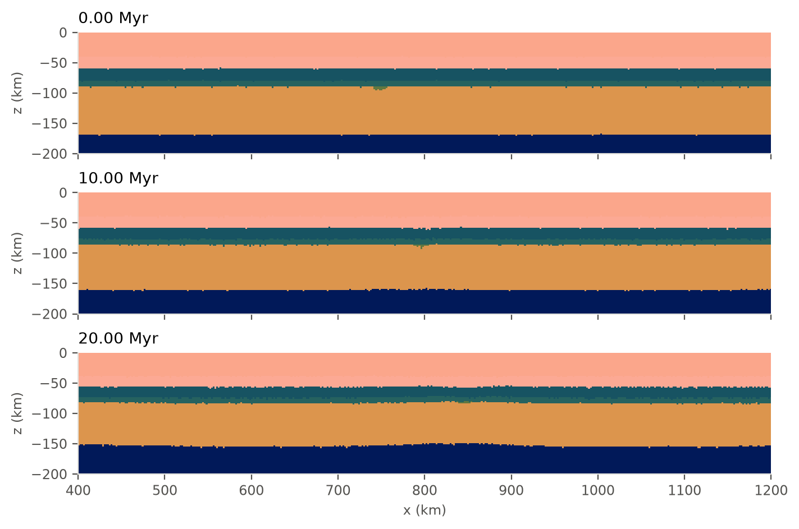
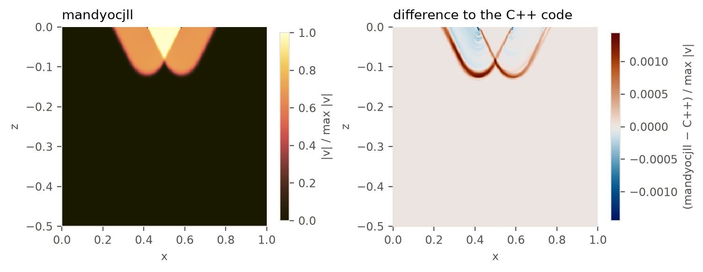
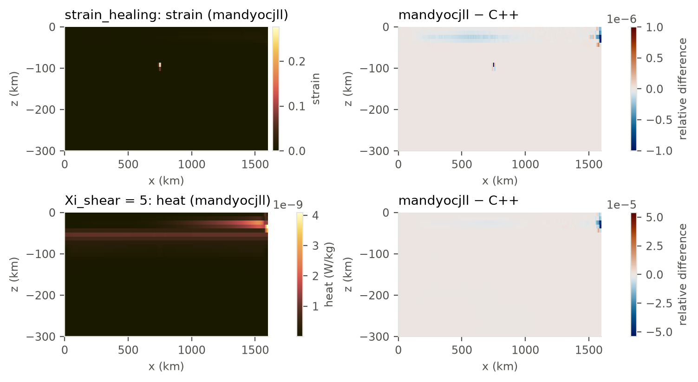
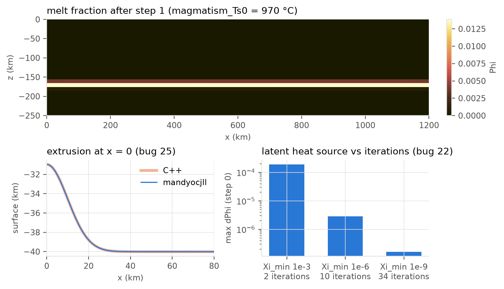
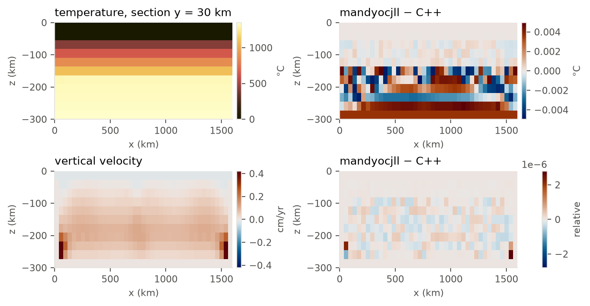

# Introdução

## O que é o mandyocjll

O mandyocjll é uma reimplementação em Julia do [Mandyoc](https://github.com/ggciag/mandyoc), o código de elementos finitos em C++ e PETSc para modelos termomecânicos da litosfera e do manto. Ele lê os mesmos arquivos de entrada (`param.txt`, `interfaces.txt`, `input_temperature_0.txt`, `input_velocity_0.txt` e os arquivos auxiliares), resolve as mesmas equações com os mesmos métodos numéricos e escreve as saídas em zarr, com os nomes, as dimensões e as unidades dos arquivos NetCDF que o [tapIOca](https://github.com/jopmas/tapioca) já usa no pós-processamento.

O objetivo do porte foi ter um código:

- **comparável com o C++**: cada parte foi validada contra o Mandyoc com as mesmas entradas, em geral até a precisão de máquina ou do solver;
- **mais fácil de ler e modificar**: o código tem cerca de 3.400 linhas de Julia (o C++ tem mais de 10.000), com nomes descritivos e comentários que apontam a função equivalente do C++;
- **independente da partição**: os resultados não dependem do número de processos MPI, o que no C++ não acontece em vários pontos;
- **com os bugs do C++ corrigidos e documentados**: 31 itens estão no documento `docs/bugs_mandyoc_cpp.pdf`, com uma sugestão de correção para o C++ e o tratamento dado no Julia.

Esta apostila explica o modelo físico, os métodos numéricos, a organização do código, como montar, rodar e processar um cenário, e como o código foi validado. Ela foi escrita para quem vai trabalhar no código depois: a ideia é que, ao terminar, o leitor saiba onde está cada parte do modelo e como testar uma mudança.

## O que foi portado

| Parte | 2D | 3D |
|---|---|---|
| Partículas (DMSwarm): criação, advecção, migração entre processos, adição e remoção | sim | sim |
| Equação do calor (elementos bilineares/trilineares, Crank-Nicolson, upwind) | sim | sim |
| Stokes Q1-P0 com iterações de Uzawa, FSSA, iterações não lineares e rampa de viscosidade | sim | sim |
| 13 reologias, plasticidade de Drucker-Prager com amolecimento, cicatrização da deformação | sim | sim |
| Calor radiogênico, adiabático e por cisalhamento; difusividade por camada; fluxo de calor na base | sim | sim |
| Superfície livre rastreada e processos superficiais (difusão e três modos de sedimentação) | sim | não (como no C++) |
| Magmatismo: fusão parcial, calor latente, extração e extrusão | sim | não (como no C++) |
| Fronteira periódica | sim | não (como no C++) |
| Velocidades variáveis no tempo (`scale_bcv.txt`, `multi_velocity`) | sim | sim |
| `nondimensionalization` | sim (em unidades SI) | sim |
| Saídas zarr, conversão para NetCDF | sim | sim |
| Runge-Kutta 4 (`RK4`) | aguardando a correção no C++ | aguardando |

## Como ler esta apostila

O capítulo 2 resume o modelo físico, e o capítulo 3 os métodos numéricos. Quem só quer rodar cenários pode ir direto para os capítulos 5 e 6. O capítulo 4 descreve a arquitetura do código e é o ponto de partida para quem vai modificá-lo; o capítulo 9 traz o roteiro de desenvolvimento. O capítulo 7 mostra as comparações com o C++, com figuras.

Os nomes de variáveis seguem a tabela `docs/rename_table.csv`: cada nome do Mandyoc ganhou um nome descritivo, e o nome antigo aparece num comentário ao lado (por exemplo, `particle_swarm # dms`). Assim, quem conhece o C++ encontra o equivalente com uma busca pelo nome antigo.

# O modelo físico

## Equações de conservação

O Mandyoc resolve o escoamento de um fluido muito viscoso e incompressível (aproximação de Boussinesq), acoplado à equação do calor. Em 2D as coordenadas são $(x, z)$, com $z$ para cima e $z = 0$ no topo do domínio; em 3D, $(x, y, z)$.

Conservação da massa (incompressibilidade):

$$
\nabla \cdot \mathbf{v} = 0
$$

Conservação do momento (Stokes, sem inércia):

$$
-\nabla p + \nabla \cdot \left( 2 \eta \, \dot{\boldsymbol{\varepsilon}} \right) + \rho(T) \, \mathbf{g} = 0,
\qquad
\dot{\boldsymbol{\varepsilon}} = \tfrac{1}{2} \left( \nabla \mathbf{v} + \nabla \mathbf{v}^T \right)
$$

com a densidade dependente da temperatura,

$$
\rho(T) = \rho_0 \left( 1 - \alpha T \right),
$$

em que $\rho_0$ é a densidade da camada (linha `rho` de `interfaces.txt`) e $\alpha$ o coeficiente de expansão térmica. No código, a força de volume aparece como `density_variation` (`dRho` no C++), igual a $\alpha g \rho_m T - g \rho_0$, com $\rho_m$ a densidade do manto (`density_mantle`).

Conservação da energia:

$$
\frac{\partial T}{\partial t} + \mathbf{v} \cdot \nabla T = \nabla \cdot \left( \kappa \nabla T \right) + \frac{H}{c_p} - \frac{\alpha g T v_z}{c_p} + \frac{\Xi \, 4 \eta \dot{\varepsilon}_{II}^2}{\rho c_p} - \frac{T \, \Delta S}{c_p} \frac{\Delta \phi}{\Delta t}
$$

Os termos do lado direito são, na ordem: difusão (com a difusividade $\kappa$ de cada camada, linha `k`), calor radiogênico (`radiogenic_component`), aquecimento adiabático (`adiabatic_component`), aquecimento por cisalhamento (`shear_heating`, com o fator $\Xi$ = `Xi_shear`) e o calor latente da fusão (`magmatism`). Cada um é ligado por uma chave de `param.txt`.

## Reologia

A viscosidade é calculada em cada partícula, a partir da temperatura, da pressão, da taxa de deformação e da deformação acumulada. A reologia mais usada nos cenários do tapIOca é a lei de potência com ativação térmica (reologias 9 e 19):

$$
\eta = C \, A^{-1/n} \, \dot{\varepsilon}_{II}^{(1-n)/n} \exp\left( \frac{Q + V p}{n R T} \right)
$$

com $A$, $n$, $Q$ e $V$ da camada (linhas `A`, `n`, `Q`, `V` de `interfaces.txt`) e $C$ o fator de escala da camada (linha `C`). O segundo invariante da taxa de deformação é

$$
\dot{\varepsilon}_{II} = \sqrt{\tfrac{1}{2} \, \dot{\varepsilon}'_{ij} \dot{\varepsilon}'_{ij}}
$$

com $\dot{\varepsilon}'$ a parte deviatórica. Ao todo há 13 reologias (de 0 a 10, 19 e 70), na função `particle_viscosity` de `src/rheology.jl`, equivalente a `calc_visco_ponto` do C++.

**Plasticidade.** Com `plasticity = on` e as iterações não lineares ligadas, a viscosidade é limitada pelo critério de Drucker-Prager:

$$
\tau_y = c \cos\varphi + p \sin\varphi, \qquad \eta \le \frac{\tau_y}{2 \dot{\varepsilon}_{II}}
$$

A coesão $c$ e o ângulo de atrito $\varphi$ diminuem linearmente com a deformação acumulada entre `weakening_min` e `weakening_max` (fragilização por deformação). A deformação acumulada de cada partícula cresce com $\dot{\varepsilon}_{II} \, \Delta t$ e, com `strain_healing`, diminui com uma taxa que depende da temperatura.

**Limites.** A viscosidade final fica entre `viscosity_min` e `viscosity_max`. Com `initial_dynamic_range`, esses limites são abertos aos poucos no início (rampa de Gerya), uma década por vez a partir da média geométrica, o que estabiliza as primeiras iterações.

## O ar e a superfície livre

O topo do modelo é uma camada de "ar grudento" (*sticky air*): uma camada de densidade baixa e viscosidade pequena, que deixa a superfície da rocha se mover livremente. Onde a densidade nodal é menor que `air_threshold_density`, a temperatura é zerada. Com `sticky_blanket_air`, os elementos na interface ar-rocha recebem uma viscosidade mínima de 50 vezes `viscosity_min`.

A estabilização FSSA (*free surface stabilization algorithm*, Kaus et al., 2010) evita a oscilação da superfície livre com passos de tempo grandes. Ela acrescenta à matriz um termo que antecipa a mudança da força de volume quando a interface se move:

$$
\Delta \mathbf{f} \approx \theta \, \Delta t \, (\mathbf{v} \cdot \nabla) \left( \rho \mathbf{g} \right)
$$

com $\theta$ = `theta_FSSA`. No C++ o peso efetivo do termo é diferente do nominal (bug 7) e em 3D o termo não tem efeito (bug 29); o mandyocjll usa a forma consistente e, com `fssa_legacy = True`, reproduz o termo do C++ para comparação.

## Processos superficiais

Com `sp_surface_tracking`, uma linha de pontos acompanha a superfície da rocha. Ela é transportada com a velocidade e reamostrada em pontos igualmente espaçados a cada passo. Com `sp_surface_processes`, a superfície também muda por difusão ($\partial h / \partial t = \kappa_s \nabla^2 h$, modo `diffusion`) ou por sedimentação (`sedimentation_only`, `sedimentation_rate_limited` e `theunissen_sedimentation`, este com progradação a partir das margens). Depois da mudança, as partículas de ar abaixo da superfície viram sedimento (a camada ativa de `sediment_layers.txt`), e as de rocha acima dela viram ar.

## Magmatismo

Com `magmatism = on`, cada partícula acompanha a fração de fusão $\phi$, a depleção $X = 1/(1-\phi)$ e o último incremento de fusão $\Delta\phi$. O solidus sobe com a pressão e com a depleção:

$$
T_s = T_{s0} + \frac{dT_s}{dP} \, p + \frac{dT_s}{dX} \, (X - 1)
$$

e o incremento é o que leva a temperatura ao solidus, $\Delta \phi = (T - T_s)/(L + f_X)$, com $L = T \Delta S / c_p$. A fusão reduz a viscosidade (Lu e Huismans, 2021) e consome calor latente. Com `magmatism_extraction = on` e a superfície rastreada, o magma novo é extraído nos passos de saída e colocado sobre a superfície como uma gaussiana de 10 km de largura, acima da partícula mais rasa que fundiu, na camada `magmatic_layer`. O capítulo 8 lista os problemas desse esquema no C++ (bugs 22 a 26), que o mandyocjll repete para manter a comparação.

# Métodos numéricos

## Malha e decomposição em processos

O domínio é uma malha regular com `nx` × `nz` nós (`nx` × `ny` × `nz` em 3D), criada como uma DMDA do PETSc. Há duas DMDAs com a mesma partição: `da_Veloc`, com 2 (ou 3) graus de liberdade por nó para a velocidade, e `da_Thermal`, com 1 grau de liberdade para a temperatura e os campos nodais (densidade, calor, deformação). Cada processo MPI fica com um bloco de nós e enxerga uma camada de nós vizinhos (*ghosts*).

**Regra de posse dos elementos.** Um elemento pertence ao processo dono do seu nó inferior esquerdo (inferior esquerdo frontal, em 3D). Essa regra, a mesma do C++, decide quem monta cada elemento e quem guarda as partículas de cada elemento.

**Campos por elemento.** A viscosidade, a difusividade e a pressão são constantes no elemento e ficam guardadas no nó inferior esquerdo (a pressão, no primeiro componente da velocidade desse nó em `da_Veloc`).

## Stokes: elementos Q1-P0 e iterações de Uzawa

A velocidade é bilinear (trilinear em 3D) e a pressão é constante em cada elemento (Q1-P0). As integrais usam quadratura de Gauss com 3 pontos por direção (9 pontos em 2D, 27 em 3D). O sistema discreto tem a forma de ponto de sela:

$$
\begin{pmatrix} K & G \\ G^T & 0 \end{pmatrix}
\begin{pmatrix} \mathbf{u} \\ \mathbf{p} \end{pmatrix}
=
\begin{pmatrix} \mathbf{f} \\ 0 \end{pmatrix}
$$

com $K$ sendo a matriz de rigidez viscosa, $G$ o gradiente da pressão e $G^T$ o divergente. Em vez de montar o sistema inteiro, o Mandyoc usa o método de Uzawa com gradientes conjugados na pressão:

1. resolver $K \mathbf{u} = \mathbf{f} - G \mathbf{p}$ (MUMPS, `solver = direct`, ou um método iterativo do PETSc);
2. calcular o resíduo da incompressibilidade, $\mathbf{r} = G^T \mathbf{u}$;
3. atualizar a pressão por gradientes conjugados, com o pré-condicionador diagonal $\left( \sum G_{ie}^2 / K_{ii} \right)^{-1}$, e repetir até $\|\mathbf{r}\|^2 <$ `denok`.

A fatoração de $K$ é feita uma vez por montagem e reaproveitada em todas as iterações de Uzawa, o que torna o método barato. O critério `denok` é absoluto e depende das unidades (bug 28): em SI, use valores da ordem de 1e-14, como o tapIOca.

**Iterações não lineares.** Como a viscosidade depende da taxa de deformação, a velocidade é recalculada (iterações de Picard) até a mudança relativa da velocidade ficar abaixo de `Xi_min`, com no máximo 700 iterações. A cada iteração, as viscosidades das partículas são recalculadas com a velocidade nova.

## Equação do calor

A temperatura usa elementos bilineares (trilineares em 3D) e o método $\theta$ no tempo, com $\theta = 0{,}5$ (Crank-Nicolson):

$$
\left( M + \theta \Delta t \, C^{n+1} \right) \mathbf{T}^{n+1} = \left( M - (1-\theta) \Delta t \, C^{n} \right) \mathbf{T}^{n} + \Delta t \, \mathbf{F}
$$

com $M$ a matriz de massa, $C$ a soma da advecção e da difusão e $\mathbf{F}$ as fontes de calor. A advecção recebe a difusão artificial de linha de corrente do Mandyoc (um *upwind* com peso que depende do número de Péclet do elemento), que evita oscilações quando a advecção domina. As temperaturas fixas (topo, base e, conforme `param.txt`, os lados) entram por uma máscara.

## Partículas

As propriedades do material (camada, deformação acumulada, fração de fusão) são carregadas por partículas (método *particle-in-cell*), guardadas num DMSwarm do PETSc. Cada elemento recebe `particles_per_element` partículas, distribuídas numa grade regular e perturbadas aleatoriamente por `particles_perturb_factor`.

**Das partículas para a malha.** A densidade, o calor e a deformação nodais são médias ponderadas pelos pesos bilineares das partículas vizinhas. A viscosidade e a difusividade de cada elemento são a média (aritmética ou harmônica, `viscosity_mean_method`) das partículas do elemento.

**Advecção.** As partículas são movidas pelo método de Euler em 4 subpassos por passo de tempo, com a velocidade interpolada entre a solução do passo anterior e a do passo atual. Depois do movimento, o DMSwarm migra as partículas que mudaram de processo. A localização da partícula na malha usa a regra de posse dos elementos; em 2D, sem fronteira periódica, é a do PETSc (`native`), e nos outros casos é uma função em Julia ligada ao PETSc por uma pequena biblioteca em C (`csrc/cell_dm_shim.c`).

**Adição e remoção.** Elementos com partículas demais (mais de 10% acima do nominal) perdem a partícula mais próxima de outra; elementos com partículas de menos ganham uma partícula, escolhida entre 10 candidatas como a mais distante das existentes, que herda as propriedades da partícula mais próxima. No mandyocjll, os desempates e os sorteios dependem só da posição e do passo, e não do processo: por isso o resultado não muda com o número de processos.

## Passo de tempo e laço principal

O passo de tempo é 10% do tempo que a maior velocidade leva para atravessar um elemento, dividido por `sub_division_time_step` e limitado por `dt_max`. Cada passo faz:

```latex
\begin{center}
\begin{tikzpicture}[node distance=5mm, every node/.style={font=\small},
  box/.style={draw, rounded corners, fill=blue!6, minimum width=8.6cm, minimum height=7mm, align=center},
  opt/.style={draw, rounded corners, dashed, fill=orange!8, minimum width=8.6cm, minimum height=7mm, align=center}]
\node[opt] (a) {mudanças programadas: \texttt{scale\_bcv.txt}, \texttt{multi\_veloc.txt}, sedimentação, nível de base};
\node[box, below=of a] (b) {equação do calor (\texttt{thermal\_step!})};
\node[box, below=of b] (c) {Stokes não linear: partículas $\to$ malha, Stokes/Uzawa, até \texttt{Xi\_min} (\texttt{solve\_velocity\_total!})};
\node[box, below=of c] (d) {4 subpassos de Euler: partículas (deformação, viscosidade, fusão, posição) e superfície};
\node[box, below=of d] (e) {adição e remoção de partículas (\texttt{add\_remove\_particles!})};
\node[opt, below=of e] (f) {superfície: reamostragem, processos superficiais, extração de magma};
\node[box, below=of f] (g) {saída zarr a cada \texttt{step\_print} passos; novo $\Delta t$};
\foreach \u/\v in {a/b,b/c,c/d,d/e,e/f,f/g} \draw[-{Stealth}] (\u) -- (\v);
\end{tikzpicture}
\end{center}
```

As caixas tracejadas só existem quando a opção correspondente está ligada.

## Superfície e magmatismo

A superfície rastreada é um vetor de pontos $(x, z)$ replicado em todos os processos. A advecção de cada ponto é feita pelo processo dono do elemento onde ele está, e o resultado é somado entre os processos. Isso evita os problemas da superfície dividida entre processos do C++ (bugs 18 a 21) e mantém os resultados independentes da partição.

A fusão é calculada em cada atualização das partículas (`melt_particle!`), em precisão simples, como no C++. O calor latente entra na equação do calor com o $\Delta\phi$ projetado na malha, e a extração (`extract_melt!`, em `src/magmatism.jl`) soma o aumento de $\phi$ nos nós desde a última extração.

## Três dimensões

O 3D usa os mesmos métodos com hexaedros trilineares: 27 pontos de Gauss, $K$ de 24 × 24 por elemento, o mesmo Uzawa (a função `uzawa!` é compartilhada) e a advecção de Euler. As partículas são localizadas pela mesma regra, com a biblioteca em C. As saídas têm as dimensões `(time, z, y, x)`. Como no C++, não há superfície rastreada, magmatismo nem fronteira periódica em 3D; diferente do C++, o mandyocjll tem em 3D a difusividade por camada, o aquecimento por cisalhamento, o fluxo de calor na base e o FSSA.

## Adimensionalização

No C++, `nondimensionalization = True` resolve as equações em unidades da profundidade, da viscosidade máxima, da gravidade, da densidade do manto e da difusividade. Essas unidades se misturam com anos no passo de tempo, em `time_max` e nos tempos dos arquivos (bug 27). Uma mudança de unidades não muda a solução, então o mandyocjll resolve em SI também com a opção ligada, converte `denok` (que depende das unidades) e escreve as escalas em `dimensional_convertion.txt`.

# Arquitetura do código

## Arquivos

| Arquivo | Conteúdo |
|---|---|
| `src/Mandyocjll.jl` | o módulo: inclui os arquivos abaixo, na ordem |
| `src/parameters.jl` | `ModelParameters`: todas as opções de uma rodada, com os padrões do C++ |
| `src/particle_swarm.jl` | DMDAs 2D, DMSwarm, localização das partículas (shim ou nativa), advecção |
| `src/thermal.jl`, `src/thermal3d.jl` | matrizes de elemento e montagem da equação do calor em 2D e 3D |
| `src/stokes.jl`, `src/stokes3d.jl` | Stokes Q1-P0, FSSA, iterações de Uzawa (`uzawa!`) |
| `src/rheology.jl` | `LayerProperties`, viscosidade das partículas, partículas $\to$ malha, ar, pressão, o `Model` e o passo de tempo |
| `src/rheology3d.jl` | as mesmas funções em 3D e o construtor `Model3D` |
| `src/surface.jl` | superfície rastreada e processos superficiais |
| `src/magmatism.jl` | extração e extrusão do magma |
| `src/reader.jl` | leitura de `param.txt`, `interfaces.txt`, campos ASCII e arquivos com tempos |
| `src/particle_control.jl` | adição e remoção de partículas em 2D |
| `src/output.jl` | escritor de zarr (formato v2, sem dependências externas) |
| `src/main.jl` | `run_scenario`: lê o cenário, monta o modelo e roda o laço de tempo |
| `bin/mandyocjll` | linha de comando, lançamento do MPI e uso da imagem compilada |
| `csrc/cell_dm_shim.c` | 12 linhas de C que ligam a localização das partículas em Julia ao PETSc |
| `tools/use_petsc.jl` | escolhe o PETSc e o MPI (`LocalPreferences.toml`) |
| `tools/zarr2nc.py` | converte as saídas zarr em NetCDF |
| `test/` | testes e comparações com o C++ |
| `examples/` | exemplos do Mandyoc, também como cenários SVG do tapIOca |
| `docs/` | documentação, a tabela de nomes, o documento de bugs e esta apostila |

## Estruturas de dados

**`ModelParameters`** (`src/parameters.jl`) guarda todas as opções numéricas e físicas, com nomes descritivos e o nome do C++ no comentário. É imutável: o construtor `ModelParameters(d)` (em `src/reader.jl`) lê o dicionário de `param.txt` e aplica os padrões do Mandyoc.

**`LayerProperties`** guarda as propriedades de cada camada (`interfaces.txt`): densidade, fator de viscosidade, calor radiogênico, parâmetros de fluência, coesão e atrito, difusividade, a deformação inicial de cada camada e a profundidade das interfaces.

**`Model`** (`src/rheology.jl`) é o estado de uma rodada: as DMDAs, o swarm de partículas, os campos da malha (`MeshFields`: densidade, calor, deformação, viscosidade, difusividade, força de volume, campos da fusão), a temperatura, as velocidades (`velocity`, a do passo anterior, e `velocity_next`, a atual), a pressão, os resolvedores térmico e de Stokes, o tempo e o passo. O mesmo tipo serve para 2D e 3D; os campos guardam os objetos de cada dimensão.

**`ThermalSolver` / `ThermalSolver3D`** e **`StokesSolver` / `StokesSolver3D`** guardam as matrizes de elemento, a matriz global, os vetores auxiliares e o KSP do PETSc. A montagem é feita por funções separadas (`assemble_lhs!`, `assemble_rhs!`, `assemble_velocity!`).

**`Surface`** (`src/surface.jl`) guarda os pontos da superfície e as opções dos processos superficiais, e **`MeltExtraction`** o volume já extraído.

## Como o código acessa os dados do PETSc

O mandyocjll usa o PETSc.jl só como uma camada fina sobre a biblioteca C (`LibPETSc`): as chamadas têm os mesmos nomes e argumentos do C. Três ferramentas aparecem em todo o código:

- `PETSc.with_local_array!(f, vec)` dá acesso ao vetor como um `Array` de Julia, sem cópia, e o devolve ao PETSc no fim;
- `local_view(da, a, dof)` (e `local_view3`) transforma esse array num `OffsetArray` indexado pelos índices globais da malha, com os *ghosts*: `T[i, k]` é a temperatura do nó $(i, k)$, como `tt[k][i]` no C++;
- `with_field(f, swarm, nome, T)` dá acesso a um campo das partículas (`"layer"`, `"strain_fac"`, as coordenadas).

O padrão de uma montagem é: copiar o vetor global para o local (`global_to_local`), percorrer os elementos do processo (`element_ranges`), somar as contribuições no vetor local e devolver ao global com `DMLocalToGlobal` em modo `ADD_VALUES`.

## Paralelismo

Tudo roda em MPI, com uma DMDA dividida entre os processos. As matrizes e vetores globais são distribuídos pelo PETSc; os laços sobre elementos e partículas são locais. Algumas reduções explícitas usam o MPI.jl (`MPI.Allreduce`), por exemplo no passo de tempo e no volume de magma. As saídas são reunidas por variável: cada variável é escrita por um processo diferente, em paralelo.

Com mais de um processo, o `bin/mandyocjll` fixa `OMP_NUM_THREADS = 1`: o BLAS do conda abre várias threads por processo, que disputam os núcleos e deixam a rodada até 9 vezes mais lenta.

## Imagem compilada

Julia compila o código na primeira execução, o que levaria 10 a 15 s por rodada. O `make` gera uma imagem compilada com o PackageCompiler (`bin/mandyocjll.dylib` ou `.so`), e o `bin/mandyocjll` a usa quando ela está em dia com o código. Um checksum em `bin/mandyocjll.stamp` detecta mudanças: depois de mudar `src/`, rode `make image`, ou o programa avisa e roda sem a imagem.

## Saídas

Cada variável é um *store* zarr (`density.zarr`, `temperature.zarr`, ...), com um *chunk* por saída, nos nomes e unidades do tapIOca. O escritor (`src/output.jl`) implementa o formato zarr v2 com compressão zlib, sem bibliotecas externas, e grava cada arquivo de forma atômica, de modo que é possível ler as saídas enquanto a rodada continua.

# Instalação e execução

## Instalação

```bash
git clone git@github.com:jopmas/mandyocjll.git ~/opt/mandyocjll
cd ~/opt/mandyocjll
make
```

O `make` escolhe o PETSc e o MPI (no Linux, um PETSc compilado em `~/opt/petsc`, se compatível; no MacOS, o do ambiente conda `tapioca`), instala os pacotes de Julia, compila a biblioteca em C e gera a imagem. Os detalhes estão em `docs/installation.md`. No Hypatia, o mandyocjll está em `~/opt/mandyocjll`, ligado ao PETSc `optimized-v3.24.1-openmpi`.

## Execução

O mandyocjll roda na pasta do cenário, como o Mandyoc:

```bash
cd pasta/do/cenario
~/opt/mandyocjll/bin/mandyocjll -n 4 -seed 0,2 -strain_seed 0.0,1.0
```

| Opção | |
|---|---|
| `-n N` | número de processos MPI |
| `-i PASTA`, `-o PASTA` | pasta do cenário e pasta das saídas |
| `-seed L1,L2,...` | camadas com deformação inicial |
| `-strain_seed S1,S2,...` | deformação inicial dessas camadas |
| `-h_air H` | espessura do ar (m), para reologias que dependem da profundidade |
| `-Px N`, `-Py N`, `-Pz N` | processos em cada direção |
| outras | vão para o PETSc (por exemplo, `-log_view`) |

No Hypatia, dentro de um job do SLURM, o lançamento é feito pelo `mpirun` do módulo, e não pela opção `-n`; o script `run_hypatia.sh` gerado pelo tapIOca já faz isso:

```bash
mpirun -n $NUMBER_OF_CORES --map-by :OVERSUBSCRIBE ~/opt/mandyocjll/bin/mandyocjll
```

# Tutorial: do cenário às figuras

Este capítulo mostra o caminho completo de um cenário, com comandos que foram executados para esta apostila.

## Montar o cenário com o tapIOca

O jeito mais simples de montar um cenário é desenhá-lo num SVG e usar o `tapioca-svg`, que cria todas as entradas e o script de execução. Os exemplos do Mandyoc já desenhados estão em `examples/examples_svg`. Para o rift continental, em malha de 10 km e 20 Myr:

```bash
conda activate tapioca
cd ~/opt/mandyocjll/examples/examples_svg/continental_rift
tapioca-svg continental_rift.svg -o inputs --dx 10 --dz 10 --time-max 20 \
    --code mandyocjll --system mac --ncores 4
```

O `--code mandyocjll` faz o script de execução chamar o mandyocjll (também pode estar na forma `setup` do SVG). A pasta `inputs` recebe `param.txt`, `interfaces.txt`, `input_temperature_0.txt`, `input_velocity_0.txt`, as figuras do cenário e o script `run_mac.sh` (`run_linux.sh` ou `run_hypatia.sh`, conforme `--system`).


## Montar um cenário sem o tapIOca

As entradas são arquivos de texto simples. Cada exemplo em `examples/` tem um `make_inputs.py`, testado, que as escreve em Python (são as células dos notebooks do Mandyoc). O formato é:

- `interfaces.txt`: uma linha por propriedade das camadas (`C`, `rho`, `H`, `A`, `n`, `Q`, `V` e, opcionais, `k`, `cohesion_min`, ...), com um valor por camada, da mais funda para a mais rasa; depois, uma linha por nó do topo com a profundidade de cada interface (em 3D, x varia mais rápido);
- `input_temperature_0.txt` e `input_velocity_0.txt`: 4 linhas de cabeçalho e um valor (ou um por componente) por nó, com x variando mais rápido e z de baixo para cima;
- `param.txt`: as chaves do Mandyoc (`docs/parameters.md` lista as que o mandyocjll lê).

Veja `examples/continental_rift/make_inputs.py` como modelo.

## Rodar

```bash
cd inputs
bash run_mac.sh
```

O script roda o mandyocjll (o log vai para `FD.out`) e, se a rodada terminar sem erro, faz o pós-processamento: cria os `.nc` com `tools/zarr2nc.py`, gera os *snapshots* e o vídeo com os scripts de `post_processing` e compacta o cenário num zip. O rift deste tutorial (161 × 31 nós, 2.000 passos) levou poucos minutos com 4 processos em um Mac Mini.

## Processar as saídas

As saídas zarr são lidas diretamente com o xarray, inclusive durante a rodada:

```python
import xarray as xr
import matplotlib.pyplot as plt

T = xr.open_zarr("temperature.zarr").temperature        # dimensões (time, z, x)
v = xr.open_zarr("velocity.zarr")                       # vx, vz
lith = xr.open_zarr("lithology.zarr").lithology         # malha 5 vezes mais fina

print(T.time.values)                                    # tempos das saídas (Myr)
T.sel(time=10, method="nearest").plot(cmap="inferno")   # temperatura perto de 10 Myr
plt.savefig("temperatura_10Myr.png")

perfil = T.isel(time=-1).sel(x=800e3, method="nearest") # perfil vertical no centro, última saída
vz_topo = v.vz.isel(z=-1)                               # velocidade vertical no topo, todas as saídas
```

Para usar as ferramentas do tapIOca, que leem NetCDF, converta:

```bash
python ~/opt/mandyocjll/tools/zarr2nc.py .               # todas as variáveis
python ~/opt/mandyocjll/tools/zarr2nc.py . temperature   # só a temperatura
```




## Um cenário 3D

Um cenário 3D tem `dimensions = 3` e as chaves `ny` e `ly` em `param.txt`. Em `interfaces.txt`, cada linha de profundidades corresponde a um nó $(i, j)$ do topo, com $x$ variando mais rápido; os campos ASCII têm um valor por nó, com $x$ mais rápido, depois $y$, depois $z$. O exemplo `examples/continental_rift_non_dimensional/model2` é um rift 3D:

```bash
cd ~/opt/mandyocjll/examples/continental_rift_non_dimensional/model2
python make_inputs.py
~/opt/mandyocjll/bin/mandyocjll -n 4 -seed 0,2 -strain_seed 0.0,1.0
```

e as saídas são lidas da mesma forma, com a dimensão `y` a mais (`T.sel(y=30e3, method="nearest")` dá uma seção).

# Validação

Cada parte do código foi validada de duas formas: por testes com solução conhecida (`test/`) e por comparação com o C++ nas mesmas entradas. As comparações usam o erro relativo na norma L2, $\|a - b\|/\|b\|$. Os detalhes de cada caso estão em `docs/validation.md`; esta seção mostra os principais.

## Testes

```bash
cd ~/opt/mandyocjll
julia --project=. test/mpirun.jl 4 test_thermal.jl       # 4 processos
julia --project=. test/mpirun.jl 4 test_stokes.jl
julia --project=. test/mpirun.jl 4 test_thermal3d.jl
julia --project=. test/mpirun.jl 4 test_stokes3d.jl
julia --project=. test/mpirun.jl 4 test_particle_control.jl native
```

Cada teste imprime `RESULT OK` ou `RESULT FAIL`. Eles verificam, entre outros: a ordem de convergência 2 da difusão e do Stokes, soluções estacionárias exatas nos nós (duas camadas de difusividade diferente, calor radiogênico, escoamento de Couette em duas camadas), o peso efetivo do FSSA, a migração de 243.000 partículas entre processos e o controle de partículas, sempre com 1 e 4 processos.


## Comparações com o C++

| Caso | Comparação | Resultado |
|---|---|---|
| Rift viscoplástico (201 × 51) | 3 passos | velocidade 2,8e-8, temperatura 8e-12 |
| Slab com lei de potência (101 × 61) | 4 passos | velocidade 4,3e-7 |
| Rift com controle de partículas | 30 passos | velocidade 8e-7, deformação 1,4e-6 |
| Punch | passo 0 | velocidade 6,3e-4 (as iterações não convergem em nenhum dos dois códigos) |
| Campo de velocidade variável | 3 passos, inversão de `scale_bcv.txt` | velocidade 1,4e-6 |
| Cicatrização da deformação | 4 passos | velocidade 4e-6, deformação 2e-6 |
| Aquecimento por cisalhamento (`Xi_shear = 5`) | 4 passos | calor 1,6e-5 |
| Processos superficiais (4 modos) | 3 passos | superfície dentro de 0,12 m |
| Magmatismo, com e sem extração | 5 passos | fração de fusão 1,2e-5, mesmo volume extraído |
| `multi_velocity` e `basal_heat` | 4 passos | velocidade 9e-6, temperatura 2e-6 |
| `nondimensionalization` | 4 passos | velocidade 7e-5 (com as escalas) |
| 3D (41 × 5 × 11) | 3 passos | velocidade 1,2e-6, temperatura 2,2e-6 |












## Independência da partição

Em todas as comparações, o mandyocjll foi rodado também com 4 processos. Os resultados coincidem com os de 1 processo até a precisão do solver (diferenças de 1e-7 a 1e-9), inclusive com adição e remoção de partículas, processos superficiais e extração de magma. No C++, a criação das partículas, os sorteios da adição de partículas, a remoção e a superfície dependem do número de processos.

# Diferenças em relação ao C++

O documento `docs/bugs_mandyoc_cpp.pdf` lista 31 problemas do C++, cada um com o local no código, a evidência, uma sugestão de correção e o que o mandyocjll faz. Os mais relevantes para quem usa o código são:

| Item | Problema no C++ | No mandyocjll |
|---|---|---|
| 7, 29 | o peso do FSSA não é o nominal; em 3D, o termo não tem efeito | forma consistente; `fssa_legacy = True` reproduz o C++ |
| 15 | a remoção de partículas depende da ordem no processo | desempate pela posição |
| 18 a 21 | a superfície dividida entre processos perde e duplica pontos | superfície replicada |
| 22 | o calor latente usa só o último incremento das iterações | repete o C++ (documentado) |
| 23 | o calor latente ignora `magmatism_dS` | usa o parâmetro |
| 25 | sem fusão na última chamada, o magma vai para x = 0 | repete o C++, com desempate determinístico |
| 26 | `calc_magmatic_extraction` não retorna valor (para no macOS) | não se aplica |
| 27 | o modo adimensional mistura unidades no tempo | resolve em SI |
| 28 | `denok` é absoluto e depende das unidades | converte no modo adimensional e avisa |
| 31 | a pressão do topo é somada em precisão simples | precisão dupla |

Além disso, algumas opções foram mantidas exatamente como no C++ para que as comparações fossem possíveis (`cpp_order`, `fssa_legacy`, a fusão em precisão simples). Quando o C++ for corrigido, elas podem ser revistas.

# Guia para desenvolvedores

## Convenções

- Nomes descritivos, com o nome do Mandyoc no comentário (`docs/rename_table.csv`, que também registra cada nome novo).
- Comentários e mensagens em inglês.
- Uma opção de `param.txt` que muda o resultado e não foi portada deve interromper a rodada (`check_unsupported` em `src/main.jl`), nunca ser ignorada em silêncio.
- Um bug do C++ é corrigido no Julia, documentado em `docs/bugs_mandyoc_cpp.md` (refaça o PDF com `python3 docs/build_pdf.py`) e, quando útil, reproduzível com uma opção.
- O resultado não pode depender do número de processos.

## Roteiro para uma mudança

1. Leia a parte equivalente do C++ e procure os problemas dela (o documento de bugs é o lugar para anotá-los).
2. Implemente no Julia, no arquivo da seção 4.1. Um parâmetro novo entra em `ModelParameters` (`src/parameters.jl`), em `ModelParameters(d)` (`src/reader.jl`), em `docs/parameters.md` e em `docs/rename_table.csv`.
3. Escreva ou estenda um teste em `test/` com solução conhecida, se houver.
4. Compare com o C++ nas mesmas entradas, com 1 processo, `particles_perturb_factor = 0`, `random_initial_strain = 0` e `fssa_legacy = True`. Diferenças acima de 1e-5 merecem investigação.
5. Rode com 4 processos: o resultado deve ser o mesmo.
6. Rode os testes (seção 7.1), `make image` e atualize `docs/validation.md`.

## Comparar com o C++

O C++ escreve um arquivo de texto por variável e passo (`temperature_3.txt`), com 2 linhas de cabeçalho e um valor por linha, na mesma ordem dos nós do zarr (x mais rápido). Uma comparação típica em Python:

```python
import numpy as np, pandas as pd, xarray as xr
asc = lambda f: pd.read_csv(f, header=None, skiprows=2, comment="P")[0].to_numpy(float)
a = xr.open_zarr("jl/temperature.zarr").temperature[3].to_numpy().ravel()
b = asc("cpp/temperature_3.txt")
print(np.linalg.norm(a - b) / np.linalg.norm(b))
```

O C++ deve ser compilado numa cópia temporária, sem alterar os repositórios do Mandyoc, e rodado com `OMP_NUM_THREADS=1`.

## Armadilhas conhecidas

- **Imagem desatualizada**: depois de mudar `src/`, o `bin/mandyocjll` roda sem a imagem e avisa; rode `make image`.
- **Threads do BLAS**: sem `OMP_NUM_THREADS=1`, uma rodada com vários processos fica muito mais lenta.
- **Docstrings**: em Julia, duas docstrings seguidas antes de uma função fazem o carregamento falhar (`cannot document the following expression`).
- **`denok`**: em SI, valores acima de 1e-10 deixam a velocidade compressível (bug 28); o mandyocjll avisa.
- **Arquivos CRLF**: `docs/rename_table.csv` usa fim de linha CRLF; edite preservando-o.
- **Hypatia**: o código é editado no Mac e chega ao Hypatia só por `git pull`, seguido de `make`.

# Pendências

- **RK4**: o Runge-Kutta do C++ não funciona (bugs 1 e 2); será portado quando for corrigido no C++.
- **Restart** e `T_initial` diferente de 0 e 1 (use `temperature_from_ascii`).
- **3D**: superfície rastreada, processos superficiais, magmatismo e fronteira periódica, que também não existem no 3D do C++.
- **Saídas**: litologia e trajetórias de partículas em 3D.
- **Validação longa**: comparar um cenário completo com fusão natural (por exemplo, os casos `Ho35S1` de `tests_rft`) ao longo de dezenas de Myr, e o caso de referência `continental_rift_with_magmatism` dos testes do Mandyoc.
